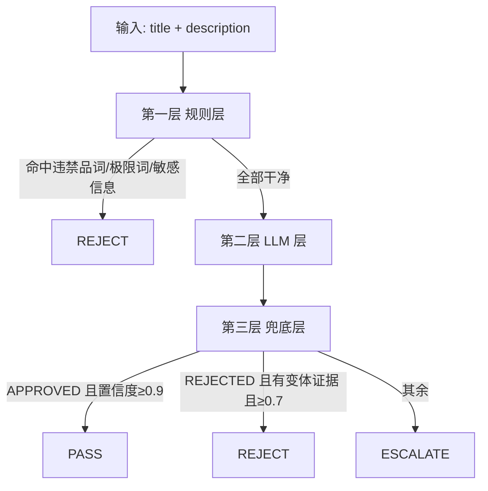

# 文本审核方案设计

> 状态：已确认方向，待实现
> 定位：合规底线——只拦违法违规，不做体验层检查

## 1. 背景与定位

商品审核 Agent 的 text_review 节点，对商品标题（title）和描述（description）做合规审核。

审核定位为**合规底线**：只拦违法违规内容，不涉及夸大宣传深度判断、图文不一致等体验层检查。

检查范围：

| # | 检查项 | 例子 | 手段 | 结论强度 |
|---|---|---|---|---|
| 1 | 违禁品词 | "枪支弹药""冰毒""发票代开" | 词库精确匹配 | 命中即 REJECT |
| 2 | 广告法极限词 | "全网最低价""销量第一""国家级" | 词库精确匹配 + 排除上下文 | 命中即 REJECT |
| 3 | 敏感信息引流 | 微信号、手机号、外部链接 | 正则 | 命中即 REJECT |
| 4 | 违禁词变体 | "最"→"zui"、"蕞低"、符号分隔 | LLM | 判出 REJECT，拿不准转人工 |

第一版**不做**：标题/描述矛盾检查（体验层，且与类目链职责重叠）。

## 2. 三层架构总览

与类目审核四层方案同构，但更薄——文本审核没有知识库召回需求，规则 + LLM 两层判断 + 一层兜底：



## 3. 第一层：规则层（零 LLM 成本）

### 3.1 规则与数据源

| 规则 | 数据源 | 命中处理 | 说明 |
|---|---|---|---|
| 违禁品词匹配 | `banned-words.txt` | REJECT，bannedWordsHit 记录命中词 | 只收强证据词，歧义词不收 |
| 广告法极限词匹配 | `limit-words.txt` | REJECT（排除上下文内跳过） | 行业惯例直接驳回，商家改词重提，不转人工 |
| 敏感信息引流 | `sensitive-patterns.txt` | REJECT | 正则：手机号、微信号、QQ、外部 URL |

处理顺序：违禁品 → 极限词 → 敏感信息。任一命中立即短路返回 REJECT。

detail 按词库来源写前缀（"含违禁品词:xx" / "含广告法极限词:xx" / "含引流信息"），人工复核台按前缀分流。

### 3.2 强证据词原则（违禁品词库选词红线）

强证据词 = 出现在商品文本里几乎必然意味着违规，误伤率接近零。

三个判据：
1. 无合法用途：想不出哪个合法商品会写它
2. 出现即违规：不需要前后文佐证
3. 反例检验：拿合法商品试，会不会误伤

| 词 | 判定 | 原因 |
|---|---|---|
| 枪支弹药 / 管制刀具 / 仿真枪 | ✅ 收 | 法律术语，合法商品不会自称 |
| 冰毒 / 海洛因 / 迷药 | ✅ 收 | 无合法用途 |
| 发票代开 | ✅ 收 | 组合词，两个合法词拼出必然违规 |
| 手枪 / 枪 / 刀 | ❌ 不收 | 玩具手枪、水枪、菜刀都是合法的 |
| 大麻 | ⚠️ 边界 | 工业大麻有合法场景，收不收取决于平台尺度（当前不收） |

歧义词一律不收，交给第二层 LLM 读上下文判断——规则层的裁决权来自"词本身零歧义"。

与类目群词表同一套词质量哲学：群词表收"命中即断定属于该群"的正证据词，违禁品词库收"命中即断定违规"的负证据词。

### 3.3 实现要点

- Hutool `WordTree`（DFA）多模匹配：一段文本一次遍历命中词库所有词，不用 for 循环 contains（词库几百词时复杂度 O(文本长度)，而非 O(词数×文本长度)）
- 排除上下文：极限词有"第一章""第一部分"等合法用法，维护排除搭配表，命中词在排除上下文内跳过

### 3.4 词库文件

```
resources/text-rules/
├── banned-words.txt        违禁品词（强证据词，命中无条件驳回）
├── limit-words.txt         广告法极限词（命中驳回，带排除上下文）
└── sensitive-patterns.txt  敏感信息正则（手机号、微信、URL）
```

分三份的原因：违禁品词和极限词的处置策略不同，词库命中 reason 文案不同，人工复核台分流依赖词库来源。

## 4. 第二层：LLM 层（规则层全干净才走到这）

任务只有一件事：**违禁词变体识别**——谐音（"zui"）、拆字、拼音、异体字（"蕞"）、符号分隔（"最 低"）。

```java
// TextJudgeService：@AiService(EXPLICIT, chatModel = "judgeModel")，提示词外置 prompts/text-judge/
// 输入：商品原文 + 违禁词库参考文本（LLM 对照找变体，不背词库）
// 返回：TextJudgeResult { verdict, riskPhrases(发现的变体词), reason, confidence }
```

设计要点：
- 复用精判模型（judgeModel），与类目精判同一套 wiring 模式
- 返回最小结论对象（复用类目精判的经验：字段越少解析越稳）
- LLM 只报变体，不管正常文本——任务边界收窄，准确率更高

## 5. 第三层：兜底层（置信度裁决）

与类目链第四层同一套阈值和防御：

| verdict | 条件 | 处理 |
|---|---|---|
| APPROVED | confidence ≥ 0.9 | PASS |
| REJECTED | 有变体证据 且 confidence ≥ 0.7 | REJECT（bannedWordsHit 并入 LLM 报出的变体） |
| 其余 | — | ESCALATE，reason 前缀"LLM 无法判断" / "置信度不足" |

防御：verdict 白名单归一化（非法值按 ESCALATE）、confidence NaN/越界按 0 处理。

阈值不对称理由（与类目链一致）：PASS 方向严（错放行平台担责），REJECT 方向宽（错杀商家重提可挽回）。

## 6. 结果映射

```
TextReviewResult:
├─ verdict        三态结论
├─ bannedWordsHit 规则层命中的词 + LLM 报出的变体词（两个来源合并）
├─ riskPhrases    LLM 判定的风险短语
└─ detail         哪一层判的 + 命中什么 + 理由（人工复核台看）
```

## 7. 与其他节点的边界

- "玩具手枪"类歧义场景：文本层放行，真伪由图片链（塑料玩具 vs 金属仿真枪）和资质（玩具枪 3C）兜底——文本层不背所有责任
- 标题与类目的一致性归类目链管，不归文本层
- 标题与描述价格矛盾（体验层）第一版不做

## 8. 决策记录

| 决策 | 结论 | 理由 |
|---|---|---|
| 违禁品词库选词标准 | 只收强证据词，歧义词交给 LLM 层 | 误伤率是唯一标准，规则层裁决权来自词零歧义 |
| 极限词命中处置 | 直接 REJECT，不转人工 | 商家改词重提成本低，广告法审核惯例 |
| 标题/描述矛盾检查 | 第一版不做 | 体验层，且与类目链职责重叠 |
| 兜底阈值 | PASS ≥ 0.9 / REJECT ≥ 0.7 | 与类目链一致，将来统一抽配置 |
| 词库匹配实现 | Hutool WordTree（DFA） | 多模匹配，避免逐词 contains |

## 9. 演进点

1. 词库 Nacos 热更（当前 classpath 文件，启动加载）
2. 词库运营后台（增删词、看误杀/漏放数据）
3. 回填体验层检查：标题/描述矛盾、夸大宣传深度判断
4. 兜底阈值从常量抽成配置项，按运营数据调参
