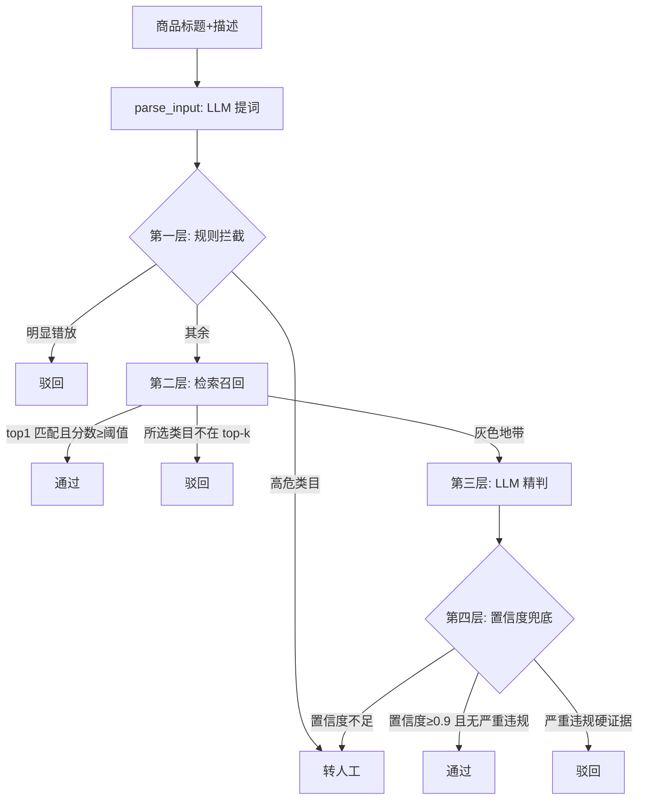

# 类目审核（category_check）方案设计

> 状态：已确认方向，parse_input 开发中
> 适用范围：review-agent-service 的 category_check 节点及其上游 parse_input 节点

## 一、问题定义

类目审核回答一个问题：**这个商品，放在商家选择的类目下，对吗？**

拆成三个子问题：

1. **知识问题**：平台的类目体系是什么（类目树、每个类目的边界）——这是"标准答案"
2. **判断问题**：商品内容（标题/描述/图片）语义上属于哪个类目——这是"理解"
3. **裁决问题**：判断与商家选择是否一致，置信度不够怎么办——这是"策略"

## 二、方案总览：分层协作（混合方案）



各层定位与成本：

| 层 | 解决 | 裁决 | 成本 |
|---|---|---|---|
| LLM 提词（parse_input） | 提取商品实体词，下游共用 | 不裁决 | 一次轻调用 |
| 规则拦截 | 确定性拦截 | 只做驳回+转人工，**无放行路径** | 0 |
| 检索召回 | 平台类目知识 + 高置信初判 | 阈值外直接裁决，阈值内下放 | 一次 embedding + 检索 |
| LLM 精判 | 灰色地带的语义判断 | 最终裁决 + 理由 | 一次重调用 |
| 置信度兜底 | 风险底线 | 不够格就转人工 | 0 |

## 三、各层设计

### 3.1 LLM 提词（parse_input 节点）

- 输入：标题 + 描述
- 输出：EXTRACTED_KEYWORDS（商品实体词列表，如 `["手机","256G","Vivo"]`）
- 用途：冲突检查输入（干净于原始标题）、检索 query 构造（去掉促销词噪声）、text_review/price_qual 复用
- 一次调用多用途分摊，是"检索质量的投资"，不是"粗筛的税"
- **演进策略**：v1 用规则版提词（分词器切词+过滤商品名词，零成本）；检索召回质量不够时再上 LLM 版提词，对比数据后决定

### 3.2 第一层：规则拦截（单闸门，无放行）

只做确定性拦截，**不做放行**。放行判断全部交给第二层（检索分数有连续兜底，比排除词可靠）。

```
规则1 主类目群冲突   命中 → 驳回
规则2 高危类目名单   命中 → 转人工（药品/医疗器械等强制人工）
都不命中              → 下放第二层
```

**为什么无放行路径**："排除词不完善"在两个方向上代价不对称——排除词漏了=错放行（最贵错误）；冲突词漏了=下放（无代价）。用词表完备性去赌最贵错误不发生，不划算。

- 规则1 数据：每主类目群一张**强证据词表**（20 群 × 30 词，配置/库，非代码）
  - 词表构造：人工编写起步 → LLM 批量生成+人工抽检（主流）→ 历史商品数据 TF-IDF 挖掘（长期，月度任务）
  - 质量红线：歧义词一票否决（"苹果"不收）；宁漏勿错杀
- 规则2 数据：高危类目名单（几十行）
- 数据复用：群词表 = 类目画像"典型商品词"按主类目群聚合+筛强证据词

### 3.3 第二层：检索召回

- 知识库：每个叶子类目一条**画像文档**（类目名+路径+描述+典型商品词+易混/禁放词+资质要求），向量化进 Milvus
- 画像初始来源：人工编写 / LLM 批量生成+人工抽检 / 历史数据挖掘（同词表的三来源）
- 检索：商品侧提词结果 embedding → Milvus top-k（k=5）→ 候选类目+相似度分数
- 初判阈值：top1==所选类目且分数≥0.85 → 通过；所选类目不在 top-k → 驳回（suggestedCategory=top1）；其余 → 下放精判
- 资质数据挂在画像里随检索带出（needQualification/requiredDocs 不用二次查询）
- 局限：细粒度边界（手机壳 vs 手机）、需推理的 case、隐晦表达——这些交给第三层

### 3.4 第三层：LLM 精判

- 输入：商品提词结果 + 候选类目（带画像）+ 商家所选类目
- 输出：结构化结果 match / suggestedCategory / needQualification / requiredDocs + 理由 + confidence
- 检索提供"平台的类目知识"，LLM 提供"语义判断"——RAG 模式

### 3.5 第四层：置信度兜底

- 原则：**宁可转人工，不可错放行**
- 阈值按裁决方向区分：通过要求置信度≥0.9（错放行代价最大）；严重违规硬证据直接驳回；其余转人工
- 与 mermaid 图 aggregate_decision 的三个分支条件一致
- LLM 自报 confidence 不是真概率，但作为"排序+阈值"信号够用

## 四、人工兜底与反馈闭环

- 转人工后**图结束**（human-as-fallback），不在图内暂停等待——人工复核后无"机器继续算"的需求，复核结果即终态
- 落库旁路异步回流：修正类目画像（禁放词）、沉淀粗筛规则、积累 few-shot 样本
- escalate case 是系统最宝贵的学习数据，没有闭环就只是管线不是系统

## 五、待定/演进点

1. **类目树主数据缺失**：catalog-service 无类目表，ProductDTO 未暴露 categoryLeafId/categoryPath——需要上游补数据，在此之前类目画像和词表先自建
2. **提词 v1→v2**：规则版 → LLM 版（视检索效果决定）
3. **快速放行通道（优化项）**：高信用卖家+低风险类目+类目名精确命中可恢复第一层放行，依赖卖家信用体系，暂不做
4. **阈值初值**：检索通过 0.85 / 精判通过 0.9 为初值，上线后用数据校准
5. **词表/画像的更新机制**：月度 TF-IDF 任务 + 人工复核回流

## 六、与现有图结构的关系

- parse_input 节点承担提词（EXTRACTED_KEYWORDS 字段已预留）
- category_check 节点内部实现 3.2~3.5 的层级管线，输出 CategoryCheckResult{match, suggestedCategory, needQualification, requiredDocs}（输出契约已定义，不变）
- escalate 分支与人工审核后台的对接在 Service 层，图外完成
