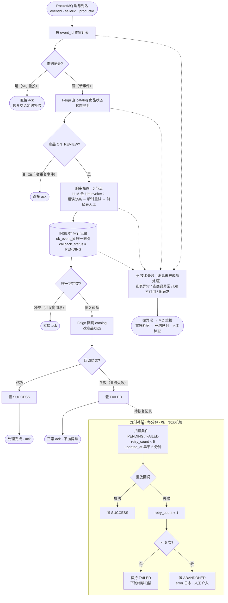
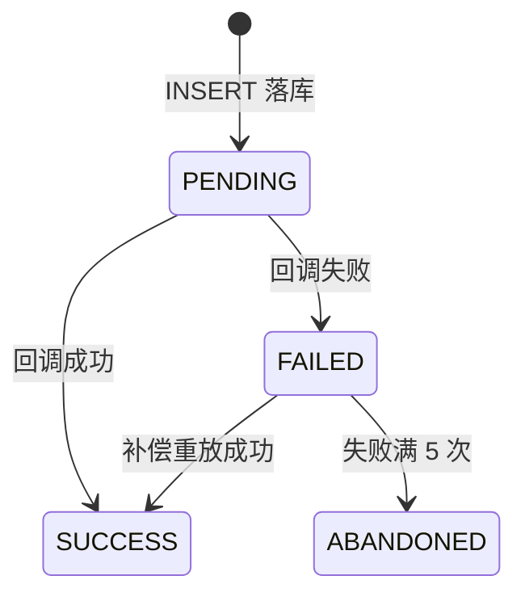

# review-agent-service 企业级化改造设计

- 日期：2026-09-17
- 状态：待评审
- 范围：`agent-service/review-agent-service`、`docker/mysql/init.sql`
- 约束：零新组件（不引入 Prometheus/Grafana/Langfuse/Sentinel），全部使用已有栈（MySQL/Redis/RocketMQ/@Scheduled/日志）

## 1. 背景与目标

审核 Agent 已具备基础能力：LangGraph4j 图编排（parse_input → 图片/文本/类目三路并行 → 价格资质 → 聚合裁决 → 通过/驳回/转人工）、规则层+LLM 双层判定、置信度兜底、traceId 贯通、Milvus 类目知识库。

本次改造补齐企业级 Agent 的三个能力缺口：**可靠性、可观测性、评测体系**，外加代码门面清理。

非目标（明确不做）：多智能体协作、A2A 协议、LLM 网关、人审工作台 UI、LLM 专项平台（Langfuse 等）、熔断器组件（Resilience4j/Sentinel）。

## 2. 现状与问题

已有基础：

- 图编排 + 三态结论 + 聚合决策（REJECTED > ESCALATED > APPROVED 优先级）
- LLM 输出防御：verdict 白名单归一化、置信度 NaN/越界按 0 处理、节点无结果按 ESCALATED 兜底
- traceId 从 MQ 消息提取写入 MDC，日志全链路可检索

问题清单：

| # | 问题 | 影响 |
|---|------|------|
| 2 | 审核决策不落库，只有日志 | 无法审计追溯、无法统计观测、评测无数据来源 |
| 3 | LLM 调用无错误分类和重试，超时/5xx 直接炸穿节点 | 仅靠聚合兜底，瞬时故障也转人工，无自愈 |
| 4 | 回调 catalog 失败后依赖 MQ 重投，重投期间商品卡 ON_REVIEW；重投会重跑整图（重复 LLM 花费） | 无补偿机制，成本浪费 |
| 5 | 无业务指标和统计（通过率/转人工率/成本） | 无法回答"Agent 表现如何" |
| 6 | 无评测体系 | 改 prompt/阈值/模型无量化验证手段 |
| 7 | API key 明文在 `application-dev.yml`；`RagServcie`/`RagServiceImpl` 空实现 + 拼写错误；`review-agent-service-api` 空模块；`application.yml` 错位注释 | 代码门面问题 |

## 3. 改造总览

| 工作项 | 内容 | 新增组件 |
|--------|------|---------|
| 可靠性 | 审计落库、eventId 幂等改造、消费简化、LlmInvoker 容错封装、定时补偿 | 无 |
| 可观测性 | 审计表即观测、每日统计任务、阈值轻告警、可选 Micrometer | 无 |
| 评测 | 标注评测集、dry-run Runner、三指标报告、门禁机制 | 无 |
| 清理 | key 环境变量化、删空实现、移除空模块、修注释 | 无 |

## 4. 可靠性设计

### 4.0 整体流程图



图例：实线 = 正常执行流；虚线 = 异常流（技术失败 → 抛异常 → 重投）+ 数据供给（FAILED 记录 → 补偿扫描）

### 4.1 审核审计落库

`init.sql` 新增 `review_agent_db` 库和表 `t_product_review_record`：

```sql
CREATE TABLE t_product_review_record (
    id BIGINT AUTO_INCREMENT PRIMARY KEY,
    event_id VARCHAR(64) NOT NULL COMMENT '审核事件ID（幂等键，唯一）',
    product_id BIGINT NOT NULL COMMENT '商品ID',
    seller_id BIGINT NOT NULL COMMENT '卖家ID',
    trace_id VARCHAR(64) COMMENT '链路追踪ID',
    decision VARCHAR(16) NOT NULL COMMENT 'APPROVED/REJECTED/ESCALATED',
    decision_reason TEXT COMMENT '裁决理由（含各节点驳回/转人工原因）',
    node_results JSON COMMENT '四路节点结论（verdict/reason/命中证据）',
    llm_usage JSON COMMENT '各模型 prompt/completion tokens、耗时',
    graph_cost_ms BIGINT COMMENT '整图执行耗时',
    callback_status smallint(6) NOT NULL DEFAULT '0' COMMENT '0=PENDING, 1=SUCCESS, 2=FAILED, 3=ABANDONED',
    callback_retry_count INT NOT NULL DEFAULT 0 COMMENT '回调重试次数（补偿扫描用）',
    created_at DATETIME NOT NULL DEFAULT CURRENT_TIMESTAMP,
    updated_at DATETIME NOT NULL DEFAULT CURRENT_TIMESTAMP ON UPDATE CURRENT_TIMESTAMP,
    UNIQUE KEY uk_event_id (event_id),
    KEY idx_product_id (product_id)
) COMMENT='商品审核审计记录';
```

要点：

- review-agent-service 补充 MyBatis-Plus + MySQL 驱动依赖（与其他服务同栈）
- **写库时机：图执行完、Feign 回调之前**（决策先行）。正确性前提：图执行是幂等纯计算（图内不写库、不发消息、只做决策——现有代码已符合）
- 提交点（落库）之前崩溃 → MQ 重投重跑图，只是多花 token，无错误副作用；提交点之后失败 → 恢复交给定时补偿（4.4）
- 注意：`init.sql` 只在 MySQL 容器首次初始化时执行，已有数据卷需手动执行 DDL 或 `docker-compose down -v`

### 4.2 MQ 幂等改造与消费简化

| 重复来源 | eventId 表现 | 防线 |
|---------|-------------|------|
| broker 重投（消费超时/失败重投） | 相同 | 审计表 `uk_event_id`：查到即 ack |
| 生产者同对象重发（发送 ACK 丢失，RocketMQ 内部重试） | 相同 | 审计表 `uk_event_id`：查到即 ack |
| 生产者重复调用（应用重试时重新生成消息，新 UUID） | 不同 | 状态守卫：商品非 ON_REVIEW 直接跳过 |

- **回调失败不抛异常**：审核是分钟级流程，业务容忍分钟级恢复延迟（对比人工审核的分钟~小时级），恢复全权交给定时补偿（4.4），消费端保持简单
- **原则**：MQ 重投只负责"消息被成功处理"的投递契约，业务失败不借用它重试（坏消息反复重投会占用消费线程、重试策略错位、死信语义混乱）。异常分类（实现要点）：

| 异常 | 分类 | 处理 |
|------|------|------|
| 查商品 Feign 失败 / DB 不可用 / 图执行异常 | 技术失败：消息未被成功处理 | 抛异常 → MQ 重投（图幂等纯计算，重跑无害） |
| 回调 catalog 失败 | 业务失败：处理完成、下游未生效 | 置 FAILED → 正常 ack → 定时补偿接管 |
| 商品非 ON_REVIEW / 审计表已存在 | 正常跳过 | ack |

- 死信队列定位：技术失败重投耗尽的终态（消息未处理成功，人工检查）；与审计表 ABANDONED（业务未办成）平行，各归各的人工介入
- 消费逻辑重写为：

```
收到消息 → 按 event_id 查审计表
  ├─ 存在 → 直接 ack（后续恢复由定时补偿任务全权负责）
  └─ 不存在 → 校验商品 ON_REVIEW → 跑图 → 落审计表（唯一键冲突 → ack，
       覆盖并发同消息场景）→ 回调 catalog
         ├─ 成功 → 置 SUCCESS
         └─ 失败 → 置 FAILED（正常 ack，不抛异常）
```

- 简化代价（如实记录）：恢复延迟从秒级变为最坏约 6 分钟（扫描周期 1 分钟 + 重放窗口 5 分钟），业务容忍度内；恢复机制收敛为单一入口（定时补偿），该任务成为关键路径——其自身可用性靠日志与每日统计任务中的补偿成功率指标保障
- **已知边界（接受残余风险）**：同一商品的创建事件与重提事件恰好并发消费（不同 eventId、不同队列）→ 双跑图双回调，后到者覆盖先到者。此场景两次事件间隔一整轮审核、天然串行，量级下概率极低，接受

### 4.3 LLM 调用容错封装（LlmInvoker）

- 所有 LLM 调用（TextJudgeService、CategoryJudgeService、KeywordExtractor 等）统一走 `LlmInvoker`
- 错误分类：超时/429/5xx → **可重试**（最多 2 次，指数退避 + 抖动）；401/400/非法输出 → **不重试**（重试无意义还烧钱）
- 重试耗尽 → 抛业务异常 → 节点捕获 → 该路结论按 ESCALATED（复用现有聚合兜底语义）
- 降级方向是转人工而非自动通过/驳回：审核领域错放行是平台担责，宁可保守
- 打点：每次调用的耗时、token、错误分类（供统计任务聚合）
- 不引入 Resilience4j/Sentinel 的理由：LLM 调用点只有 4-5 处、流量小、降级语义与审核领域绑定，轻封装足够；什么规模才需要熔断器是问答要点素材

### 4.4 回调补偿（唯一恢复机制）

- 定位：回调恢复的全权负责者。消费端回调失败只置 FAILED 并正常 ack（见 4.2），不依赖 MQ 重投；MQ 重投只负责技术失败（落库前崩溃、基础设施不可用）的重处理——图是幂等纯计算，重跑无害
- `@Scheduled` 定时扫描（每分钟）：扫描 `callback_status IN (PENDING, FAILED)`、`callback_retry_count < 5`、`updated_at` 早于重放窗口（5 分钟，避开在途处理）的记录 → 重放回调 → 成功置 SUCCESS，失败 retry_count + 1，超过 5 次置 ABANDONED 并打 error 日志（人工介入）
- 恢复延迟上界：约 6 分钟（扫描周期 1 分钟 + 重放窗口 5 分钟）——审核业务分钟级容忍度内（对比人工审核分钟~小时级）
- 补偿记录自包含：决策先行落库使记录带有 product_id/seller_id/decision，补偿只是重放一次回调，无需判断"该补什么"

callback_status 状态机（数字编码对应 DDL 的 smallint）：



编码对照：PENDING(0) / SUCCESS(1) / FAILED(2) / ABANDONED(3)
- 依赖确认（实现时验证）：catalog 的 `productAudit` 接口幂等（同商品重复设置同一终态无副作用）
- 已知边界：`callback_status = SUCCESS` 的语义是"回调调用成功"而非"业务必然生效"——catalog 返回成功后自身崩溃的极小窗口，补偿扫描不会触碰（状态已 SUCCESS）；彻底消除需要对账机制（定时比对审计表与 catalog 状态），量级下接受残余风险

## 5. 可观测性设计

### 5.1 审计表即观测

通过率、转人工率、单件成本 = 对审计表的一条 SQL。不单独建设指标链路。

### 5.2 每日统计任务 + 轻告警

- `@Scheduled` 每日统计任务：昨日审核总量、三态分布、转人工率、LLM token 总量与估算成本（聚合 `llm_usage` JSON），结构化日志输出（可被日志服务检索）
- 统计任务同时输出补偿成功率（重放成功数 / 重放尝试数）——补偿是唯一恢复机制后，它自己的健康度必须可见
- 阈值判断：转人工率超过配置阈值（相对基线的倍数）→ error 日志（告警信号），通知渠道留配置位不实现
- 转人工率突增 = 模型异常信号，是审核 Agent 的典型告警

### 5.3 可选 Micrometer

Actuator + Micrometer 埋点（审核耗时、错误计数）作为可选加项，仅本地 `/actuator/metrics` 查看，不引入采集与展示组件。

### 5.4 为什么不上重型组件

| 组件 | 不上的理由 |
|------|-----------|
| Prometheus/Grafana | 量级小、无现成监控栈，审计表 + 统计任务已覆盖需求；上重型组件是浪费 |
| Langfuse | Java SDK 弱、评估资产要独立于平台管理（JSON + 代码可移植）、2 周内自建讲得更深 |
| Sentinel/Resilience4j | LLM 调用点少、流量小，轻封装足够 |

## 6. 评测体系设计

### 6.1 评测集

- 位置：`review-agent-service/src/main/resources/eval/dataset/`，JSON 文件，git 管理（评估资产独立于 Agent 框架，可移植）
- 规模：首批 40 条人工标注，分层抽样（违规是长尾，随机抽会全是正常样本）

| 类别 | 数量 | 期望 |
|------|------|------|
| 正常通过 | 8 | APPROVED |
| 明显违规 | 8 | REJECTED |
| 变体违规（谐音/拆字/拼音） | 8 | REJECTED |
| 灰色低置信 | 8 | ESCALATED |
| 类目错放 | 4 | REJECTED |
| 图片问题 | 4 | REJECTED |

- 样本结构：`caseId / category / title / description / expected(三态) / evidence(期望命中证据)`
- 标准答案在运行前人工标注（golden set），由业务规则确定，独立于 Agent 输出
- 批次化：首批聚焦文本/类目/价格判定主路，图片类样本后续批次补充

### 6.2 Runner（dry-run）

- review-agent-service 内新增 `eval` 包 + `@Profile("eval")` 的 `CommandLineRunner`，跑完 `System.exit(0)`
- **直接调 `ReviewGraphRunner`，不经过 `ReviewServiceImpl`**：不查商品、不回调 catalog、不写审计表，评测不污染生产数据
- 运行：`mvn spring-boot:run -pl review-agent-service -Dspring-boot.run.profiles=eval`，真实调用 LLM 与 Milvus（成本如实发生）

### 6.3 指标与报告

- 3×3 混淆矩阵（期望三态 × 实际三态）
- 错放行率 = 期望驳回被判通过 / 期望驳回总数（第一优先级，平台担责方向）
- 错杀率 = 期望通过被判驳回 / 期望通过总数（商家可申诉，容忍度高）
- 转人工率 = 实际转人工 / 总数（兜底机制触发率，非越低越好）
- 按类别汇总 + 逐条明细表（caseId、期望、实际、命中证据、理由）
- 报告：控制台 + Markdown `eval/report/<日期>-<说明>.md`
- 首批不做成本统计（token 计量等 LlmInvoker 落地后自然获得）

### 6.4 门禁机制

- 判定相关改动（prompt/阈值/模型/词库/聚合逻辑/节点逻辑/RAG 参数）→ 必须跑评测；非判定改动（落库/幂等/日志/定时任务）→ 单元测试即可
- 两层门槛：绝对值红线（错放行率最严——审核合规风险；错杀率可放宽——可申诉）+ 基线不退化（指标不差于改前）
- 三个指标一起看：错放行率压到 0 但转人工率过高 = 全甩人工，试水目标未达成
- 小样本诚实：40 条样本一条翻转即 2.5 个百分点，看方向与具体翻车样本，不对小数点较真
- 流程：改前跑基线 → 改后跑 → 对比两份报告

### 6.5 明确不做（每条有理由）

| 不做 | 理由 |
|------|------|
| LLM-as-judge 自动判分 | 三态判定人工标注即可，LLM 判分不准还烧钱 |
| CI 集成自动跑评测 | 改动频率低，手动跑够用 |
| 评测平台 | 评估资产独立于平台，JSON + 代码 runner 可移植 |
| 评测集入库 | JSON 文件 git 管理，天然带版本 |

## 7. 清理项

1. `application-dev.yml` 三个 DeepSeek key 与 Milvus 密码 → `${DEEPSEEK_API_KEY:}` / `${MILVUS_PASSWORD:}` 环境变量占位
2. 删除 `RagServcie.java`、`RagServiceImpl.java`、垃圾文件 `RagServiceImpl.java~`
3. 移除 `review-agent-service-api` 空模块（实现时确认无其他依赖方，含 test-service）
4. 修复 `application.yml` 中 `name: review-agent-service # 主键自增` 错位注释

## 8. 测试策略

新代码按 TDD 开发：

- `LlmInvoker`：错误分类、重试次数与退避、耗尽后异常
- 消费者短路逻辑：审计表命中/未命中分支、终态判断
- 统计任务：聚合计算、阈值判断
- 评测 Runner：指标计算（用 mock 图输出验证三率与矩阵）

## 9. 时间线（约 1.5 周）

| 天数 | 内容 |
|------|------|
| 第 1-2 天 | 可靠性：审计表 + eventId 幂等 + 重入短路 + LlmInvoker + 补偿任务 |
| 第 3-4 天 | 可观测性：统计任务 + 轻告警 + 日志 |
| 第 5-6 天 | 评测：标注集 + runner + 首份真实报告 |
| 第 7 天 | 清理项 + 交付物文档 |

## 10. 交付物

1. 代码改造（上述四个工作项）
2. 评测报告示例（真实数字——未来面试报得出的量级）
3. 面试问答要点文档：架构分层答法（模式/载体/系统形态）、可靠性决策与反面方案、观测选型理由（为什么不上 Prometheus/Langfuse）、评测框架与门禁机制、RAG 裁剪理由、embedding 选型理由链、为什么不用多智能体
4. 简历 bullet 模板（3-5 条，每条锚定真实实现）
